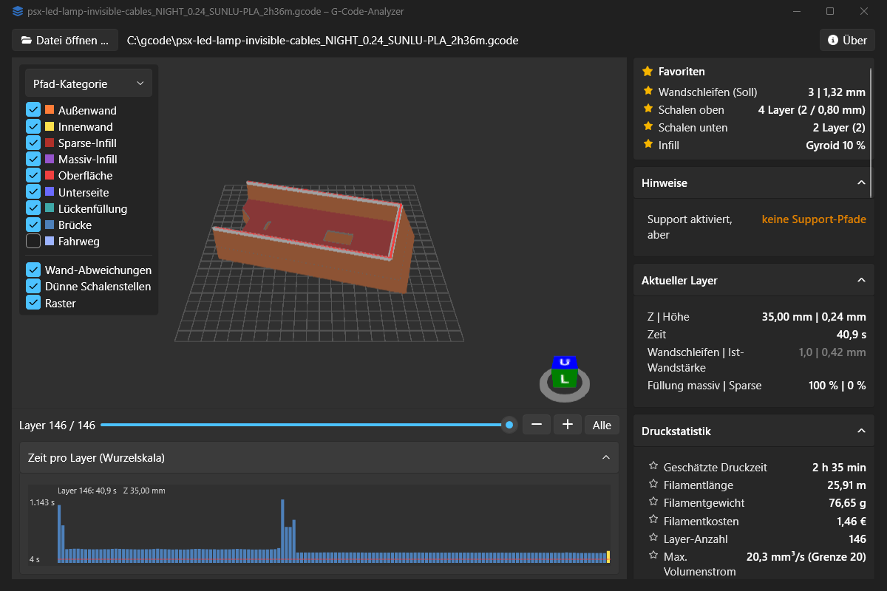
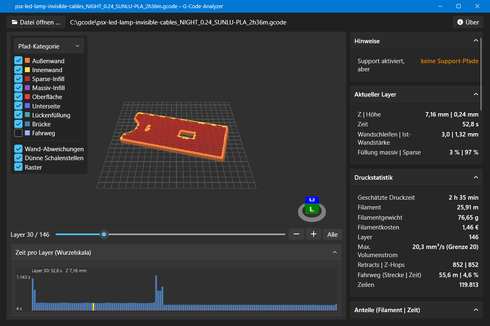
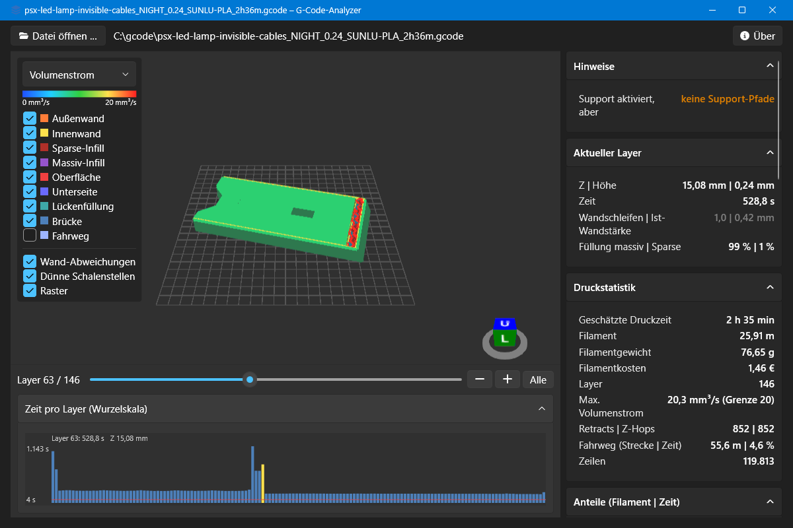
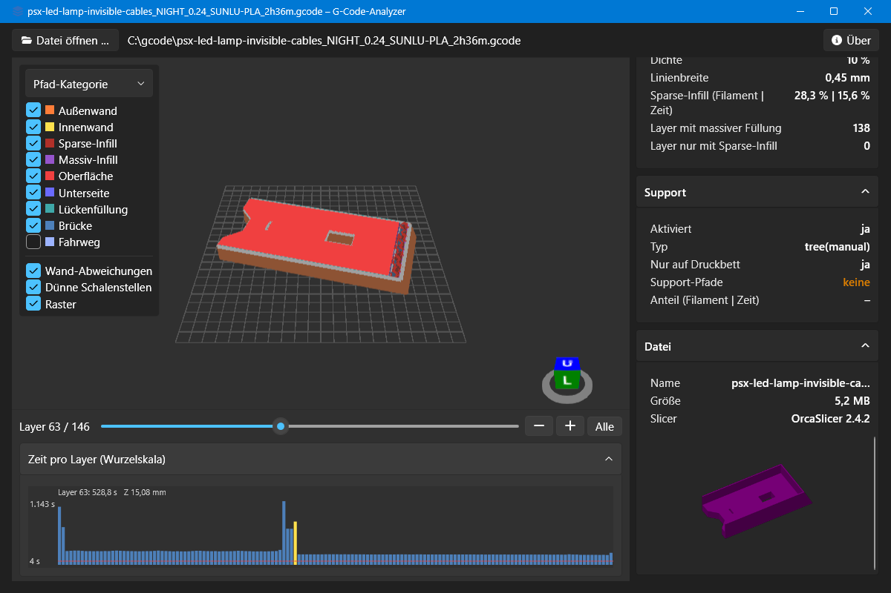

# G-Code-Analyzer

Windows-Programm, das fertig geslicte G-Code-Dateien auswertet und in 3D zeigt. Es prüft, ob der Druck den Slicer-Einstellungen entspricht: Wandstärke, Schalenschichten oben und unten, Infill und Support. Dazu gibt es Druckstatistik, Layerzeiten und Volumenstrom. Die App ist deutschsprachig und läuft komplett offline.



## Funktionen

- **Favoriten** ganz oben in der Seitenleiste: Wandschleifen, Schalenschichten oben und unten sowie Infill-Muster und -Dichte auf einen Blick. Jede Zeile lässt sich per Stern anheften oder lösen, die Auswahl bleibt gespeichert.
- **3D-Ansicht** aller Druckpfade mit Layer-Regler. Der aktuelle Layer ist hervorgehoben, Pfad-Kategorien, Fahrwege und Druckbett-Raster lassen sich einzeln ein- und ausblenden.
- **Einfärbung** nach Pfad-Kategorie, Geschwindigkeit, Volumenstrom oder Layerzeit.
- **Wände:**
  - Soll-Wandstärke aus den Einstellungen und Ist-Wandstärke aus den tatsächlich gedruckten Wandschleifen, je Kontur.
  - Absichtliche Abweichungen des Slicers erscheinen grau, echte Wand-Unterschreitungen rot. Absichtlich ist z. B. nur eine Wand auf der obersten Fläche oder Lückenfüllung an dünnen Stellen.
- **Schalenschichten oben und unten:**
  - eingestellt, effektiv (Maximum aus Anzahl und Mindestdicke) und gemessen.
  - Gemessen wird auf einem 1-mm-Raster. Dünne Schalenstellen werden in 3D markiert.
- **Infill:** Muster, Dichte, Linienbreite und das Verhältnis von massiver Füllung zu Sparse-Infill je Layer.
- **Support:** Einstellungen, Anteil an Filament und Zeit und ein Hinweis, wenn Support aktiviert ist, aber keine Support-Pfade erzeugt wurden.
- **Zeit pro Layer** als Diagramm. Layer unter der Mindest-Layerzeit sind rot, ein Klick springt zum Layer.
- **Statistik:** Druckzeit, Filament in m und g, Kosten, Abmessungen, Volumenstrom gegen das Filament-Limit, Retracts, Z-Hops und Fahrweg-Anteil. Dazu das eingebettete Vorschaubild.
- Helles und dunkles Design nach Windows-Einstellung, deutsches Zahlenformat.

| Infill eines mittleren Layers | Einfärbung nach Volumenstrom |
|---|---|
|  |  |



## Unterstützte Slicer

| Slicer | Stand |
|---|---|
| OrcaSlicer | vollständig, mit echter Datei getestet |
| Bambu Studio | vollständig, nach Dateiformat nachgebildet |
| PrusaSlicer / SuperSlicer | vollständig, nach Dateiformat nachgebildet |
| Cura | nur Grundwerte (Layer, Statistik), mit Hinweis |

Dateien mit mehreren Filamenten werden ausgewertet. Verbrauch und Anteile gelten dann für alle Filamente zusammen.

## Benutzung

`GcodeAnalyzer.exe` starten und eine `.gcode`-Datei ins Fenster ziehen oder über „Datei öffnen …“ wählen. Die Datei kann auch als Startargument übergeben werden.

- Linke Maustaste ziehen: drehen
- Rechte oder mittlere Maustaste ziehen: verschieben
- Mausrad: zoomen
- Doppelklick: Ansicht an das Modell anpassen

## Bauen

Voraussetzung ist das [.NET 9 SDK](https://dotnet.microsoft.com/download/dotnet/9.0), unter Windows z. B. per `winget install Microsoft.DotNet.SDK.9`.

```powershell
dotnet build                                   # alles bauen
dotnet test                                    # Tests der Analyse-Bibliothek
dotnet run --project src/GcodeAnalyzer.App     # App starten
dotnet publish src/GcodeAnalyzer.App -c Release
```

`dotnet publish` erzeugt eine einzelne, selbstständige `publish/GcodeAnalyzer.exe` (ca. 77 MB). Auf dem Zielrechner muss dafür kein .NET installiert sein.

## Aufbau

| Pfad | Inhalt |
|---|---|
| `src/GcodeAnalyzer.Core` | Analyse-Bibliothek ohne Oberfläche: G-Code rein, Analyse-Ergebnis raus |
| `src/GcodeAnalyzer.App` | WPF-Oberfläche, 3D über HelixToolkit.SharpDX |
| `tests/GcodeAnalyzer.Tests` | xUnit-Tests gegen die Referenzdatei in `input/` und kleine G-Code-Schnipsel |
| `CONTEXT.md` | Glossar der Fachbegriffe (Pfad-Kategorie, Wandschleife, Schalenschichten …) |
| `docs/adr/` | Architekturentscheidungen |

Die Arbeit wird über die GitHub-Issues geplant. Die Spec steht in Issue #1.

## Drittanbieter

- Icons: [Font Awesome Free](https://fontawesome.com) 7.3.1 (über Web Awesome) von Fonticons, Inc., lizenziert unter [CC BY 4.0](https://creativecommons.org/licenses/by/4.0/). Die Pfade sind in `src/GcodeAnalyzer.App/Icons.xaml` eingebettet.
- 3D-Darstellung: [Helix Toolkit](https://github.com/helix-toolkit/helix-toolkit) (MIT-Lizenz).
